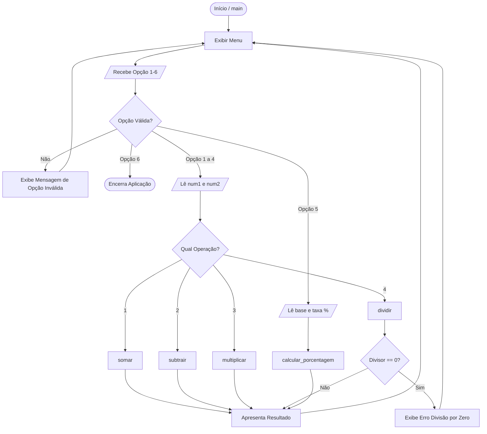

# Arquitetura e Engenharia de Evolução (Desafio 1 ➔ Desafio 2)

Este documento analisa as decisões técnicas, a organização arquitetural e a evolução promovida entre a versão inicial da calculadora e a versão expandida com auxílio do **Google Antigravity**.

---

## 1. Visão Geral da Arquitetura

O projeto adota uma arquitetura procedural modularizada, ideal para scripts e aplicações de linha de comando (*CLI*).

### Diagrama de Fluxo e Componentes

---

## 2. Comparativo de Mudanças: Desafio 1 vs. Desafio 2

| Aspecto | Desafio 1 (Versão Inicial) | Desafio 2 (Versão Evoluída) |
| :--- | :--- | :--- |
| **Operações Suportadas** | 4 operações (+, -, *, /) | 5 operações (+, -, *, / e %) |
| **Quantidade de Opções no Menu** | 5 (1 a 4 operações + 5 sair) | 6 (1 a 5 operações + 6 sair) |
| **Tratamento Semântico de I/O** | Apenas "primeiro e segundo número" | Entrada contextual para porcentagem ("valor base" e "taxa") |
| **Cobertura de Testes Automatizados** | Validações manuais via terminal | 9 testes unitários automatizados com `unittest` |
| **Estrutura de Documentação** | `README.md` | `README.md`, `TESTES.md`, `RELATORIO_VERIFICACAO.md` e `ARQUITETURA_E_EVOLUCAO.md` |

---

## 3. Boas Práticas de Engenharia Aplicadas

1. **Princípio da Responsabilidade Única (Single Responsibility Principle - SRP):**
   - Cada função aritmética é pura: recebe entradas e retorna o valor sem efeitos colaterais.
   - A entrada de dados (`obter_numero`) não realiza contas.
   - O menu (`exibir_menu`) apenas imprime a interface textual.

2. **Engenharia Defensiva (*Defensive Programming*):**
   - Falhas previsíveis (como usuário digitando letras ou dividindo por zero) são interceptadas sem propagar falhas fatais que quebrem o programa.

3. **Facilidade de Manutenção (*Maintainability*):**
   - A adição de novas operações matemáticas (ex: potenciação ou raiz quadrada no futuro) requer apenas a criação da função pura e o acréscimo de uma linha no menu e no bloco `if/elif`.
