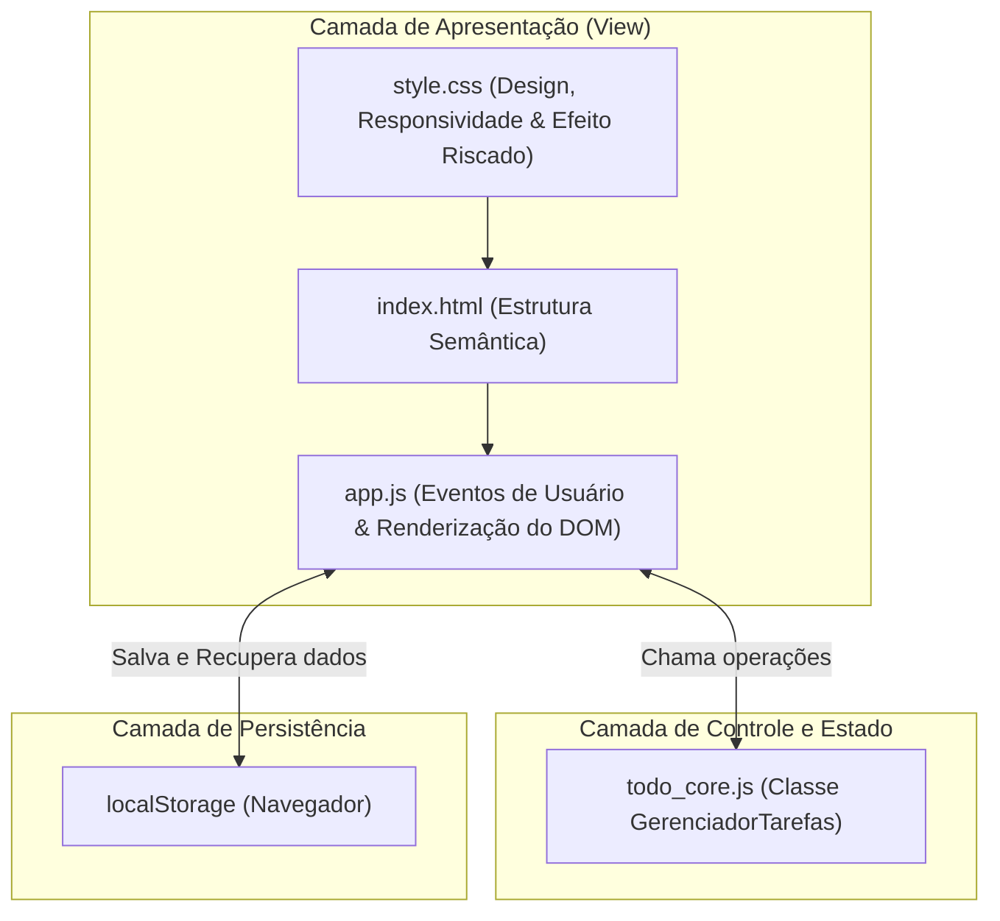

# Arquitetura e Engenharia de Software (Desafio 3)

Este documento detalha o desenho arquitetural, a separação de responsabilidades e as decisões técnicas tomadas na construção da **Lista de Tarefas** com auxílio do **Google Antigravity**.

---

## 1. Visão Geral da Arquitetura

Para garantir manutenibilidade, testabilidade e desacoplamento, adotamos o padrão de separação entre **Modelo/Regras de Negócio** e **Camada de Apresentação/View**:

---

## 2. Componentes e Papéis

### 1. `todo_core.js` (Lógica Pura de Dados)
- Não tem dependência de elementos HTML ou objetos `window` / `document`.
- Encapsula as regras de negócio: validações de string, geração de IDs únicos, alternância booleana e contagens estatísticas.
- Permite rodar testes unitários em milissegundos sem depender de navegador.

### 2. `app.js` (Controlador do DOM)
- Escuta os eventos de interação do usuário (`submit`, `click`, `input`).
- Atualiza a árvore do DOM de forma declarativa e limpa.
- Comunica-se com o `localStorage` para manter a consistência de dados entre sessões.
- Aplica sanitização contra vulnerabilidades de segurança (XSS).

### 3. `style.css` (Experiência Visual e Acessibilidade)
- Design *mobile-first*, adaptável para telas pequenas e monitores amplos.
- Regras CSS estratégicas para distinção visual:
  - Seletores compostos como `.task-item.completed .task-text` para aplicar `line-through` e cor atenuada.
  - Animações e micro-interações suaves para reforçar a resposta ao usuário.

### 4. `app_desktop.py` (Versão Desktop Alternativa)
- Construído com Python e biblioteca `tkinter`.
- Demonstra como a mesma especificação de requisitos pode ser portada com fidelidade para uma aplicação desktop nativa.

---

## 3. Como as Melhorias Sugeridas Foram Atendidas

* **Dica do Desafio:** *"Quero que as tarefas concluídas apareçam visualmente diferentes das pendentes. Implemente essa melhoria e explique quais partes do código precisaram ser modificadas."*
* **Explicação Técnica:**
  - No **HTML**, a tag `li` recebe condicionalmente a classe CSS `completed` e um badge `Concluída`.
  - No **CSS**, a classe `.completed` altera o checkbox para verde com ícone de verificado, aplica `text-decoration: line-through` no texto da tarefa e reduz a opacidade para 75%.
  - No **JavaScript**, o clique no item alterna o booleano `concluida` na entidade de dados e re-renderiza os estilos automaticamente.
